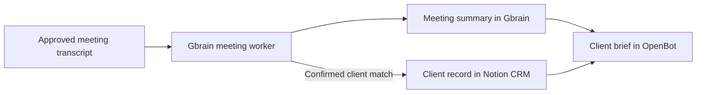

# An AI agent team for Veracto operations

Veracto uses [OpenBot](https://github.com/nightly-labs/openbot) for its internal AI team and [Gbrain](https://github.com/garrytan/gbrain) for company knowledge and background work. The agents research topics, prepare content and assemble client briefs from company records. People decide what to do with the results.

## How the team works

Chief of Staff coordinates work across the OpenBot team. Content Lead coordinates research, production and growth analysis. Team members can also work directly with the agent responsible for a task. People & Performance helps with role requirements and assessment materials.

Gbrain runs meeting processing in its own background queue. Its meeting worker reads approved transcripts, checks evidence against the source and publishes a summary with the agreements it found. When a meeting has a confirmed client record, the worker adds a link to the summary in Notion CRM. Chief of Staff uses these meeting notes alongside the current CRM record when preparing a brief.

## What we verified

After the 21 November 2026 CRM cutover, we checked that the corporate memory integration and Notion returned the same client record. In a separate check, Chief of Staff prepared a client brief and cited the original meeting and the current CRM record.

The [case study](docs/case-study.md) explains the workflow, the release checks and the original November setup. Veracto configured and integrated the upstream OpenBot and Gbrain platforms for its own work.
