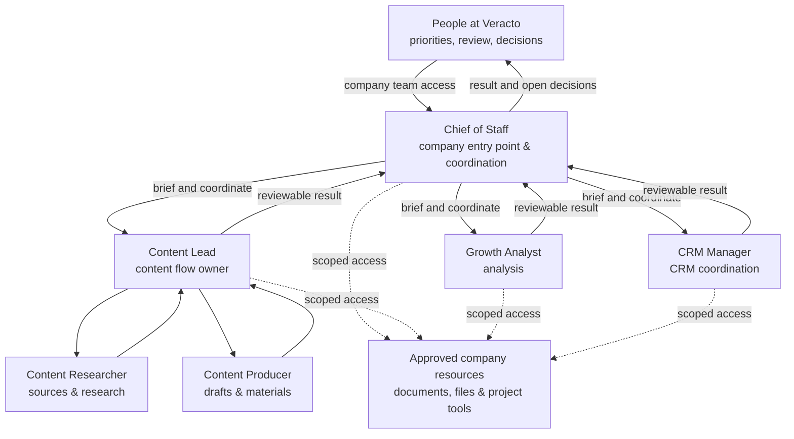

# An AI agent team for Veracto operations

How we organize specialized agents around real work: a human sets the outcome, an agent owns the flow, and specialists contribute within defined responsibilities and access boundaries. Built on [OpenBot](https://github.com/nightly-labs/openbot), this is an account of Veracto's operating setup and its ongoing development.

The system supports work such as content research and production, growth analysis and CRM coordination. Our goal is a small team that can take a task from brief to a reviewable result while keeping people responsible for decisions and publication.

## The team at a glance

The diagram shows the company team and its supported collaboration paths, not a mandatory sequence for every task. The owner can work directly with the responsible flow owner. For company members, the current access design uses the company Chief of Staff as the chat entry point. Roles and access can evolve.

## Two examples

**CRM handoff — tested.** A native Chief of Staff → CRM Manager → Chief of Staff handoff was exercised and its result reconciled during the company-access acceptance. This establishes that the handoff can complete; it is not a claim of CRM conversion, revenue or an autonomous sales process.

**Content workflow — operating design.** A content brief can move from the Content Lead to research and production: explore the market and sources → develop ideas → create materials → review. The Lead owns the flow; a human reviews decisions and publication. This illustrates role boundaries, not a claim that this exact end-to-end sequence has been measured as a completed production case.

[Read the case study](docs/case-study.md) for design decisions, verification and the next development steps.

## What we verified and what remains

In the acceptance recorded on 4 November 2026, six company roles operated under scoped access. Checks included the CRM handoff, permitted company-resource operations and denial of selected out-of-scope routes. An ephemeral member was used to test the team interface. The first login from an actual teammate's device had not yet been verified at that point.

This case describes an internal operating setup, not a commercial Veracto product or a claim that every workflow is fully autonomous. It does not include private conversations, client data, credentials, infrastructure addresses or internal agent instructions. OpenBot is an upstream project; Veracto's contribution is the way it is configured, integrated and applied to its own work.
